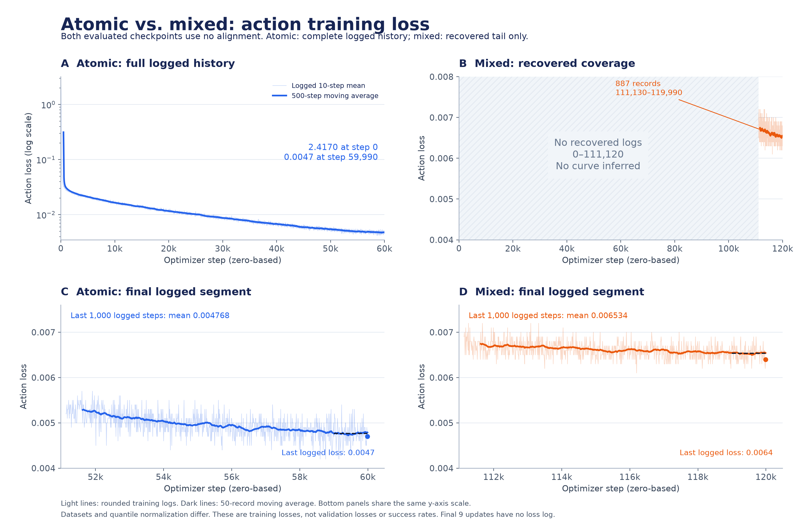

Atomic 与 mixed 训练 loss / config 对照（2026-11-05）

本报告匹配已经用于评测的两个 checkpoint：atomic noalign 59999 和 mixed noalign 119999。
更正此前将 atomic 的 alignment 实验日志用于解释评测模型的说法：atomic 目录里还有另一条 align 实验；它不属于这里的 atomic 59999，不能拼接进本曲线。两个目标实验都运行 train.py，只计算动作 flow-matching loss。

| 指标 | Atomic noalign | Mixed noalign |
|---|---:|---:|
| 可用日志步数 | 0–59990 | 111130–119990 |
| 记录数 | 6000 | 887 |
| 首条可用 loss | 2.4170（step 0） | 0.0069（step 111130；非训练起点） |
| 最后一条 loss | 0.0047 @ 59990 | 0.0064 @ 119990 |
| 末尾 100 个已记录步均值 | 0.004740 | 0.006470 |
| 末尾 1000 个已记录步均值 | 0.004768 | 0.006534 |
| 末尾 5000 个已记录步均值 | 0.004845 | 0.006563 |

atomic 从初期的 2.4170 逐步降至约 0.0047；mixed 只能看到末段，末段围绕约 0.0065 波动。缺少 mixed 前段，因此不能判断它的完整收敛速度或何时发生变化。
常规点是最近 10 步的均值，不是单个 batch 的瞬时值；表中区间均值由已四舍五入的日志计算。step 0 仅包含首次更新。末尾 59991–59999 / 119991–119999 没有单独 loss 日志，因此不能称最后记录值为最终 checkpoint 的精确单步 loss。
图 A 使用对数纵轴展示 atomic 完整下降过程；图 B 灰色区域是 mixed 未恢复区间，不插值、不补点；图 C/D 使用相同纵轴尺度展示各自末尾 887 条记录。浅线为原日志，深线为 50 条记录（约 500 步）移动平均。
两个实验的数据分布和 quantile norm 不同，不能将 loss 差值直接解释成模型效果比例。这些是训练 loss，不是验证集 loss 或评测成功率。mixed 没有保存按三个子集分别统计的 loss，无法由总均值还原三条曲线。

配置对照：

| 参数 | Atomic noalign | Mixed noalign |
|---|---|---|
| 配置名 | robocasa365_target_atomic | robocasa365_target_mixed |
| 训练入口 | scripts/train.py | scripts/train.py |
| 模型 | π0.5 / gemma_2b + gemma_300m | π0.5 / gemma_2b + gemma_300m |
| 微调方式 | 全参数微调，未使用 LoRA | 全参数微调，未使用 LoRA |
| 初始化权重 | OmniSF 35999 | OmniSF 35999 |
| 数据 | 仅 atomic | atomic + composite_seen + composite_unseen |
| 采样权重 | 1 | 1,1,1；实际概率按 weight × frames |
| 预期采样占比 | atomic 100% | 14.92% / 40.13% / 44.95% |
| 训练步数 | 60000 | 120000 |
| GPU / FSDP | 4 | 8 |
| 全局 batch | 256 | 512 |
| 每卡 batch | 64 | 64 |
| 梯度累积 | 1 | 1 |
| 总样本抽取量（不去重） | 15360000 | 61440000 |
| Alignment | 关闭；系数 0；不加载 VGGT | 关闭；系数 0；不加载 VGGT |
| 优化器 | AdamW β1=0.9, β2=0.95, ε=1e-8 | AdamW β1=0.9, β2=0.95, ε=1e-8 |
| Weight decay / 梯度裁剪 | 1e-10 / 1.0 | 1e-10 / 1.0 |
| 学习率 | cosine: 2.5e-5 → 2.5e-6 | cosine: 2.5e-5 → 2.5e-6 |
| Warmup | 1000 | 1000 |
| 学习率 decay_steps | 60000 | 120000 |
| EMA | 0.999 | 0.999 |
| State dropout | 0.25 | 0.25 |
| 随机种子 | 42 | 42 |
| 动作 horizon / 模型维度 | 50 / 32 | 50 / 32 |
| 归一化 | atomic quantile norm | 三个子集共用 mixed quantile norm |
| 数据读取线程/worker 设置 | 16 | 32 |
| 记录间隔 | 10 | 10 |
| Checkpoint 间隔 | 5000 | 5000 |
| Checkpoint 保留 | 最新；最终 59999 | 最新 + 每 20000 步；最终 119999 |
| W&B | 关闭 | 关闭 |

两组配置均由基础 Python 配置 + 启动脚本 CLI 覆盖 + 环境变量组合得到。基础文件里的默认 20000 步、batch 1、align=True 不代表最终运行参数。
atomic 使用原始 [launch.json](/share/project/robot-rfm/robot-exp/usr/ejw/posttrain/outputs/omnisf_atomic/noalign_runs/robocasa365_atomic_noalign_4gpu_20261025T081627Z/launch.json) 中的命令及记录的环境路径重建；mixed 使用当前启动脚本及准备记录重建，训练目标步数和 batch 与恢复日志一致。mixed 完整启动日志缺失，无法排除当时另有 CLI 或环境覆盖。

- Atomic 启动参数：[train_robocasa365_noalign_4gpu.sh](/home/junwue/code/omnisf/scripts/train_robocasa365_noalign_4gpu.sh)
- Mixed 启动参数：[train_robocasa365_mixed_noalign_8gpu.sh](/home/junwue/code/omnisf/scripts/train_robocasa365_mixed_noalign_8gpu.sh)
- 基础配置：[robocasa365_config.py](/home/junwue/code/omnisf/src/openpi/training/misc/robocasa365_config.py)
- Atomic 运行环境：[environment.sh](/share/project/robot-rfm/robot-exp/usr/ejw/posttrain/outputs/omnisf_atomic/noalign_runs/robocasa365_atomic_noalign_4gpu_20261025T081627Z/environment.sh)
- Mixed 路径配置：[mixed_noalign_8gpu.env.sh](/home/junwue/code/omnisf/examples/robocasa365/mixed_noalign_8gpu.env.sh)

混合采样：1,1,1 是源权重，不是三个子集各占三分之一。采样概率与 weight × frames 成正比，默认约为 atomic 14.92%、composite_seen 40.13%、composite_unseen 44.95%。这是配方期望，不是重建的实际逐样本抽样记录。
日志里的 learning_rate=0.0000 是保留四位小数造成的显示结果；配置学习率量级为 1e-5 / 1e-6，不表示停止学习。

导出文件：

- loss_curves.png / .svg / .pdf：曲线图，SVG/PDF 可用于排版。
- atomic_metrics.csv / mixed_metrics.csv：日志指标，包含原文件路径、行号和记录窗口。
- atomic_config.json / mixed_config.json：解析后的配置及重建依据。
- config_comparison.csv：可用电子表格打开的配置对照。
- loss_summary.json：统计数据与限制说明。
- source_manifest.json：证据文件和生成代码的 SHA256。

Atomic 原始日志：[train.log](/share/project/robot-rfm/robot-exp/usr/ejw/posttrain/outputs/omnisf_atomic/noalign_runs/robocasa365_atomic_noalign_4gpu_20261025T081627Z/train.log)；Mixed 恢复日志：[tmux_pane_0.log](/share/project/robot-rfm/robot-exp/usr/ejw/posttrain/outputs/omnisf_mixed/recovered_logs/20261105T052102Z/tmux_pane_0.log)。

复现：先用具备 OmniSF 依赖的 Python 运行 resolve_configs.py（仅 CPU 配置解析），再用具备 matplotlib/numpy/pandas 的 Python 运行 build_report.py；均不会加载权重或启动训练。
